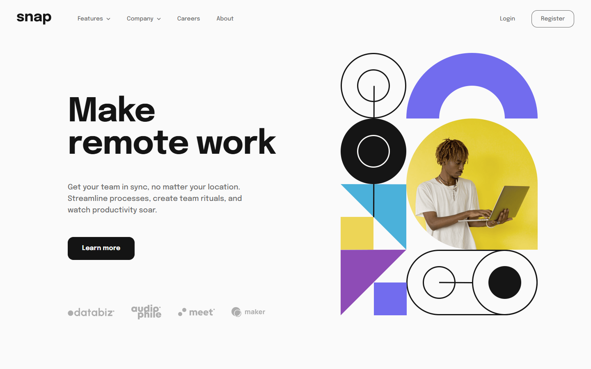
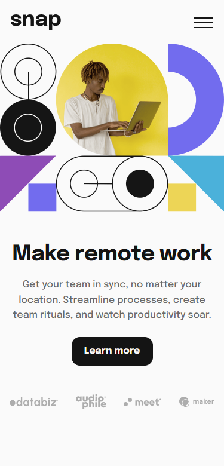

# Frontend Mentor - Intro section with dropdown navigation solution

This is a solution to the [Intro section with dropdown navigation challenge on Frontend Mentor](https://www.frontendmentor.io/challenges/intro-section-with-dropdown-navigation-ryaPetHE5). Frontend Mentor challenges help you improve your coding skills by building realistic projects.

## Table of contents

- [Overview](#overview)
  - [The challenge](#the-challenge)
  - [Screenshot](#screenshot)
  - [Links](#links)
- [My process](#my-process)
  - [Built with](#built-with)
  - [What I learned](#what-learned)
  - [Continued development](#continued-development)
  - [Useful resources](#useful-resources)
- [Development](#development)
- [Author](#author)

## Overview

### The challenge

Users should be able to:

- View the relevant dropdown menus on desktop and mobile when interacting with the navigation
- View the optimal layout for the site depending on their device's screen size
- See hover states for all interactive elements on the page

### Screenshot

| Desktop                              | Mobile                             |
| ------------------------------------ | ---------------------------------- |
|  |  |

### Links

- Solution URL: [Vercel](https://intro-section-with-dropdown-navigation-main.vercel.app/)
- Live Site URL: [mmalabugin.ru/IntroSectionWithDropdownNavigation](https://mmalabugin.ru/IntroSectionWithDropdownNavigation/)

## My process

### Built with

- **[React Router 8](https://reactrouter.com/) framework mode** (Vite 8, React 19, TypeScript) — this challenge's new framework. `ssr: false` plus `prerender: ["/"]` emits a static `index.html` with the page already in the markup, so nginx and Vercel serve one folder and the first paint does not wait on a blank SPA shell.
- **FSD layout.** React Router owns `app/` (the document shell and the route table). Slices live in `src/`: `pages/intro`, `widgets` (header, hero, footer), `features/navigation`, `shared`.
- **Pure navigation state** in `navState.ts` — desktop menus are exclusive, the mobile drawer keeps both sections open independently, and closing the drawer resets them. Vitest covers the transitions; Testing Library covers the page flows (open, switch, Escape, click outside, focus trap).
- Semantic header / nav / main / footer, `aria-expanded` on the triggers, a modal mobile drawer with Escape and a Tab cycle, and a skip link.
- CSS custom properties from the style guide, desktop-first media queries in `em`, and self-hosted **Epilogue** 500/700 (`font-display: optional` plus `<link rel="preload">` on the same hashed URL the `@font-face` uses).
- Motion (color, border, chevron rotation) only inside `@media (prefers-reduced-motion: no-preference)`.

### What I learned

- **React Router 8 still prerenders a static document when `ssr` is false.** The client build lands in `build/client`. A `basename` (no trailing slash) and Vite `base` (with a trailing slash) have to be uncommented together on the `deploy` branch, otherwise font and image URLs disagree.
- **The hero and the copy are not one flex-end group.** The illustration's top and the headline's top are independent distances from the header. Pinning both to the same cross-axis edge moves one of them off the comp. `align-items: flex-start` plus a separate `margin-block-start` on the copy keeps each one where the 1440×900 comp puts it.
- **Line breaks that the width will not reproduce need a `<br>`.** "Make / remote work" is a hard break on desktop and a single line on mobile, so the break is a class that `display: none` hides below the desktop breakpoint. The paragraph is allowed to wrap on its own, with a `max-width` tuned so "and" stays on the second line.
- **`font-display: optional` only helps if the preload URL is the file the CSS actually fetches.** Importing the woff2 from `src` lets Vite hash it once; the `links` export and `@font-face` then share that URL, and `base` prefixes both.

### Continued development

- Real destinations for Careers, About, Login, and Register instead of in-page anchors.
- A keyboard arrow-key pattern inside the desktop menus, on top of the existing Tab cycle in the mobile drawer.

### Useful resources

- [React Router framework mode](https://reactrouter.com/start/framework/rendering) — SPA mode, prerender, and `basename`.
- [Feature-Sliced Design](https://feature-sliced.design/) — where the route shell stops and the slices start.

## Development

```bash
npm install
npm run dev       # http://localhost:5173
npm run test      # vitest
npm run build     # react-router build → build/client
```

Deploy convention: `main` targets **Vercel** (the `base` / `basename` lines stay commented, so the site is served from `/`). The `deploy` branch uncomments `base: '/IntroSectionWithDropdownNavigation/'` in `vite.config.ts` and `basename: '/IntroSectionWithDropdownNavigation'` in `react-router.config.ts`. Jenkins builds that branch into an nginx image and Kubernetes serves it at `mmalabugin.ru/IntroSectionWithDropdownNavigation/`.

## Author

- Website - [mmalabugin.ru](https://mmalabugin.ru/)
- Frontend Mentor - [@1t1sCooL](https://www.frontendmentor.io/profile/1t1sCooL)
- Twitter - [@vi_el_mar](https://www.twitter.com/vi_el_mar)
- Telegram - [@ItIsCooL](https://t.me/ItIsCooL)
